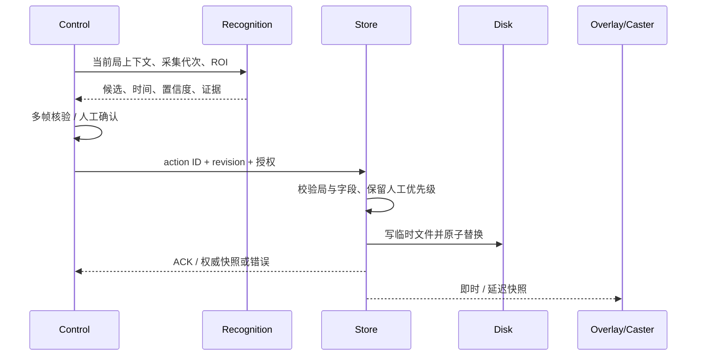

# 数据与确认边界

Control 通过 WebSocket 提交比赛动作，服务器保存后返回 ACK。识别图片经 HTTP 取得候选，采用候选才会进入比赛动作链。圆形 Ban 的锁定图可复用同一次上传，前端可直接展示与响应相同的本地输入图。[测量方法](../validation/upload-latency.md)

异步识别必须核对报告 ID、采集源 generation、请求取消状态和当前上下文。过期返回不得进入新局。发送成功不能等同于服务端保存成功；失败时保留输入并显示原因。

Series 保存赛事、队伍、赛制与比分；有效 Game 使用 `draftHistory[].id`；Postgame Report 使用同一稳定 ID。显示的 gameNumber 不能代替身份。本开发链已修复基线的跨局污染：`next_game` 清除 activePostGameReportId，commit 创建/选择本局报告，切换报告取消旧请求并清理截图/候选，历史值保留。Store 对完整快照负责，postGameActions 仅修改事务副本。
