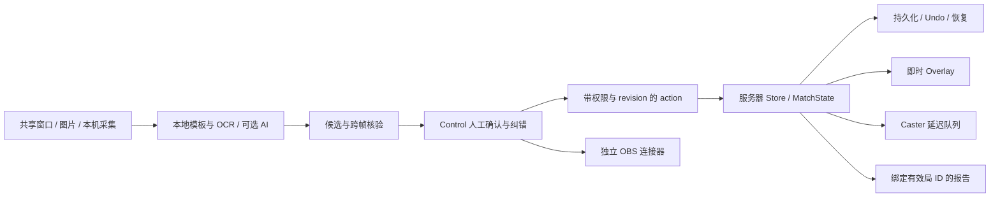

# 系统架构与渐进迁移

审计基线：`c7f0f43f9519528e87bed9f50fee40d3be01f114`（2026-11-03）。本文描述已存在的模块；后续阶段的目标不代表已经实现。

比赛数据的唯一写入点是 `Store.apply`。浏览器的输入草稿、截图和候选不等于已保存数据；OBS、Discord 的连接及发送状态也不等于比赛状态。保留这些边界，不建立第二个比分仓库。

主要集中点是 `server/server.ts`（1707 行 HTTP/WS 路由与服务装配）和 `server/store.ts`（811 行校验、迁移、事件和持久化）。`BroadcastApp.tsx` 为 388 行，`ControlDraftWorkspace.tsx` 仅 12 行，不能仅依据旧文件名假定组件仍然庞大。

迁移顺序：固定失败回归 → 修复逐局数据与纠错 → 从现有 Store 提取纯状态操作 → 按比赛阶段改善既有 FlexLayout → 识别与预算保护 → Webhook 通知 → 完整彩排。每一步保留原协议和旧数据恢复测试，不同时替换存储格式和 UI。
