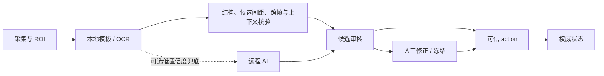

# 识别与人工保护

本地识别入口为 `capture.ts`（英雄模板）和 `gameDataRecognition.ts` / `playerRecognition.ts`（数字与玩家 OCR）。`server.ts` 装配服务；AI 服务默认 `enabled:false`。

GHUD 核验要求游戏时间前进、足够置信度、字段变化合理、采样 profile 一致；已人工输入字段跳过自动更新。连续两个 AI 结果不能冒充两次独立本地观察。静态截图不能自动播出。已有这些检查仍不等于具备经过真实遮挡样本验证的遮挡检测。

AI 采用单任务调度、精确图像缓存（4 秒）、取消与冷却；连接测试共用调度。每个实际请求（含备用模型及失败请求）在发送前通过 aiBudget 持久化预留每日次数与估算额度，默认零费用预算关闭付费发送。字节与供应商返回的 tokens 可观测，真实账单未知；估算不能代替服务商的真实消费上限。详见 Phase 4 验证报告。

GHUD 的空白内容检查现在逐字段否决 OCR/AI，恢复后重新采样。Control 按可信来源时间显示 15 秒后过期状态，保留权威数值；复杂带文字遮挡仍须真实样本验收。

元流之子需以明确变体 ID 和资源映射验证。现有合成头像回归不代表真实赛事准确率；`HOK_HERO_RECOGNITION_SAMPLE` 私有样本未提供时相关测试跳过。必须加入真实各形态及孙尚香负样本后才可报告误判率。
