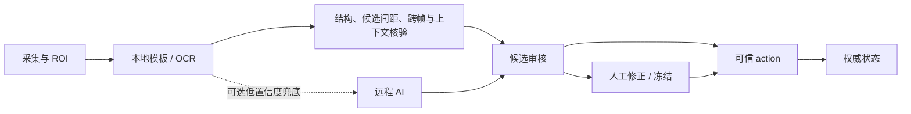

# 识别与人工保护

本地识别入口为 `capture.ts`（英雄模板）和 `gameDataRecognition.ts` / `playerRecognition.ts`（数字与玩家 OCR）。`server.ts` 装配服务；AI 服务默认 `enabled:false`。

GHUD 核验要求游戏时间前进、足够置信度、字段变化合理、采样 profile 一致；已人工输入字段跳过自动更新。连续两个 AI 结果不能冒充两次独立本地观察。静态截图不能自动播出。已有这些检查仍不等于具备经过真实遮挡样本验证的遮挡检测。

AI 当前有单任务调度、精确图像缓存（4 秒）、取消与冷却统计；缺少每日/逐局费用硬上限及完整模型费用账目。费用报告只能使用供应商可获取 usage 与明确标注的价格估算，不能将调用次数当成实际账单。

元流之子需以明确变体 ID 和资源映射验证。现有合成头像回归不代表真实赛事准确率；`HOK_HERO_RECOGNITION_SAMPLE` 私有样本未提供时相关测试跳过。必须加入真实各形态及孙尚香负样本后才可报告误判率。
