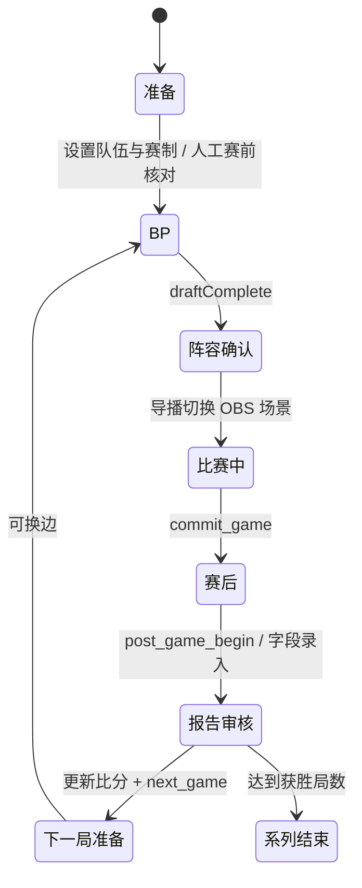

# 比赛生命周期

BO7 的盲选开局可以创建报告而不记录英雄。确认本局、进入下一局、人工撤销均须核对服务器修订号，再继续操作。[规则与报告生命周期](../design/game-rules.md)

现有实现以字段和 action 表达状态，没有单独完整生命周期枚举。以下图是操作与迁移地图，不宣称所有检查已经自动化。

`commit_game` 要求完整 BP 与有效阵容，保存稳定局 ID；它不是开局按钮。`next_game` 要求已 commit、比分推进一局且系列未结束。Undo 恢复先前快照；重复 action ID 被去重，过期 revision 被拒绝。已归档报告可独立补录，不能为了清空新局 UI 删除历史。

尚需完善：服务端可追踪的赛前检查、报告审核确认与紧急跳过记录；重赛/无效局的明确操作语义。新增这些状态前必须覆盖旧存档、Undo、重启和 Caster 延迟，避免添加与现有字段矛盾的第二套状态机。

## 无 Bot 观众 MVP 投票

`commit_game` 只提交阵容，不作为比赛结束证据。新 Store action `confirm_game_end` 为当前已提交报告记录服务器 `endedAt` 与胜方，沿用 revision、ACK、Undo 和持久化。WebSocket 成功提交后同步观察状态，避免导播立即进入下一局时漏掉发起条件；后台也观察当前状态以支持重启恢复。

`StrictVoting` 维护独立的 `strict-votes.json`。每个 reportId 只对应一个随机投票 ID，创建时冻结候选名单及 180 秒期限。每次提交先按服务器时间判断截止，再防重复、写入票数；持久化失败即停止收票。定时器负责通知，不负责决定投票是否还能接受。手动截止/取消以及过期都是终态，比赛 Undo 不回滚这个独立存档。

公告复用 `DiscordWebhook.publish` 的持久化发送日志、密钥存储、禁用 mentions、429 冷却及不确定投递保护。打开/结束公告分别有稳定 ID；重启后 `sending` 通过发送日志恢复，未知结果不自动重发。Discord 不提供跨进程端到端 exactly-once，故不承诺绝无重复公告。

公开页面是独立 lazy bundle，不连接赛事 WebSocket，不需要任何赛事访问口令。公开 API 仅提供单局冻结候选及时间/状态、接受匿名票据；管理 API 继续要求本机 Control。最终 MVP 经明确人工操作走现有 `select_mvp`，传入身份校验并使用 `activate:false`，修改历史报告时不改变当前展示。
