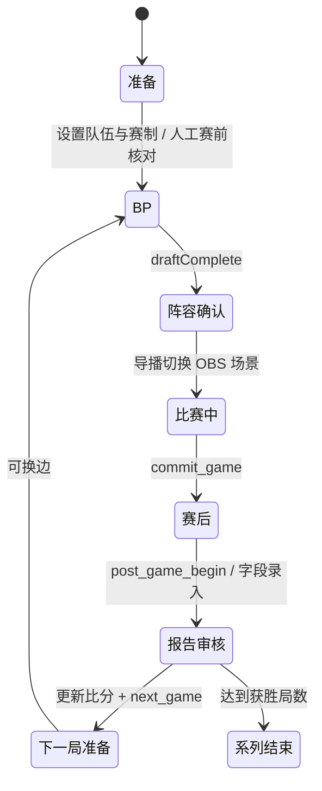

# 比赛生命周期

现有实现以字段和 action 表达状态，没有单独完整生命周期枚举。以下图是操作与迁移地图，不宣称所有检查已经自动化。

`commit_game` 要求完整 BP 与有效阵容，保存稳定局 ID；它不是开局按钮。`next_game` 要求已 commit、比分推进一局且系列未结束。Undo 恢复先前快照；重复 action ID 被去重，过期 revision 被拒绝。已归档报告可独立补录，不能为了清空新局 UI 删除历史。

尚需完善：服务端可追踪的赛前检查、报告审核确认与紧急跳过记录；重赛/无效局的明确操作语义。新增这些状态前必须覆盖旧存档、Undo、重启和 Caster 延迟，避免添加与现有字段矛盾的第二套状态机。
