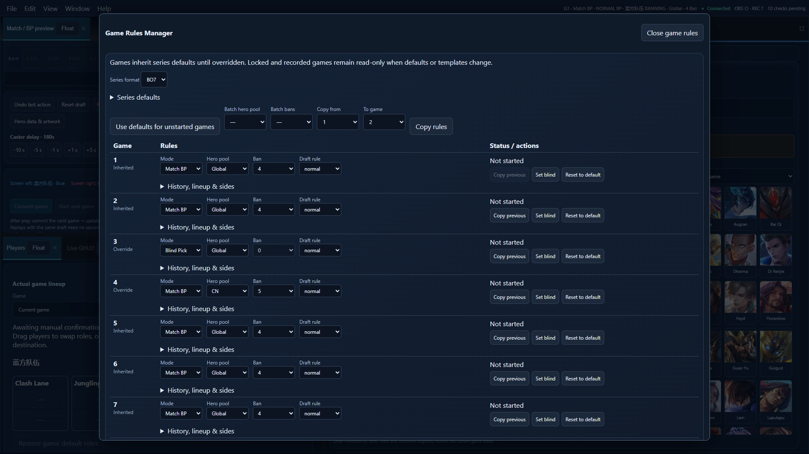
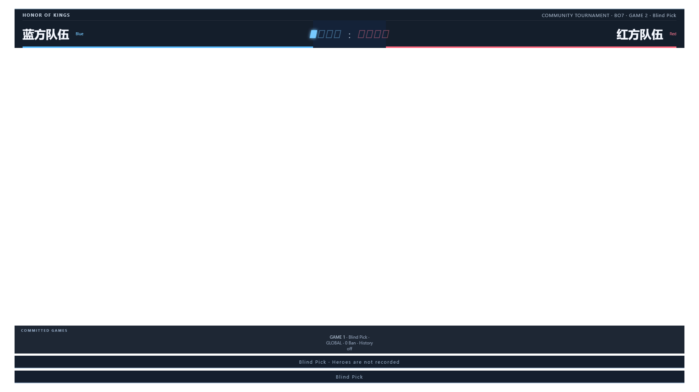

# BO7 / Game Rules Manager 验证记录

#113 已合入 main（`6b5abd9`）。后续 #115 的正常 BP → 0 Ban 盲选 → 正常 BP 回归还验证了跨局缓存和证据保护。[三局回归记录](storage-ocr-reliability.md)

开发基线：main `ddcd8e9`（PR #112），功能分支 `feat/bo7-game-rules-20261108`。开发前复核 PR #68 的双英雄池与 0–5 Ban 行为；该 PR 明确未包括盲选。

## 覆盖范围

- BO7 四胜提前结束、七局 4:3、禁止第八局；中途重启、Undo、备份恢复和独立报告。
- Match/Normal/Blind 混合，五 Ban 与零 Ban、跨池切换、规则快照不追溯。
- 历史受限/贡献的独立组合，Global、Player、换边、替补、元流形态以及旧记录迁移。
- 独立面板七行、保存 ACK、页面重载；无英雄盲选开局、GHUD 手工数据和十人报告；Caster/OBS 的盲选与 BO7 方格比分。

## 已执行结果（2026-11-08）

| 检查 | 结果 |
| --- | --- |
| `npm test` 全量服务端回归 | 403 通过，2 跳过，0 失败；约 50.4 秒 |
| BO7、规则、报告与既有 BP 针对性回归 | 50 通过，0 失败，包含最终三项边界修复 |
| `npm run test:e2e -- --reporter=line` | 全量 118 通过，0 失败；约 16.7 分钟 |
| 最终 UI / 模板专项 E2E（`game-rules` 与 `game-rules-manager-templates`） | 4 通过，0 失败；约 26.6 秒 |
| `npm run build` | 通过；保留已有的大于 500 kB 分块体积提示 |
| `npm run lint` / `npm run format:check` | 通过；仅保留 AudienceVoteView 原有两条 Fast Refresh 警告 |
| Windows `managed-process.test.ps1` / `tunnel-sync.test.ps1` | 通过；进程归属、并发启动、路径与端口保护及模拟凭据隧道契约 |
| Windows `scripts/launcher-smoke.test.ps1` | 通过；实际进程启动、健康检查、重复启动复用、完整关闭及无关进程隔离 |
| Windows `scripts/launcher-session.test.ps1` | 通过；启动器意外退出后清理自身子进程，无关进程继续运行 |

浏览器验证使用 1920 × 1080 视口，覆盖服务端 ACK、刷新持久化、盲选无 BP 输入、十人空英雄报告、比分灯与 Caster/OBS 同步。GHUD 路径使用手工数据验证隔离；未将此结果当作真实截图识别精度结论。两项跳过测试需要另行配置私有标注实战截图。

Windows 检查使用独立临时存档和动态端口，仅操作本工作树创建的进程；日志保存在工作区的 `work/game-rules-launcher-smoke.log` 与 `work/game-rules-launcher-session.log`。全量 118 项完成后，针对最后的界面锁定、下一局预览及模板导入导出又运行 4 项专项测试，全部通过。新增两项模板测试后，CI 的完整浏览器集合为 120 项；最终提交的 CI 结果见 PR Checks。

## 实机边界

自动测试不能证明真实 OBS 编码负载、实际 CN 客户端 OCR 模板或完整线下 BO7 赛事操作已经验收。使用前先以赛事最终规则彩排七局；盲选补录英雄依赖真实资料，不根据赛后数值猜英雄。
