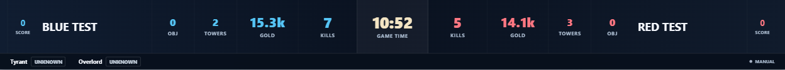

# GHUD ADB / 中立资源 / 顶栏验证 — 2026-11-06

基线：main `81752701d3993a7ab91bd72b091658128468c9f6`（#111 已合并）；独立分支 `codex/ghud-adb-objectives`。未修改生产存档、凭证、正式分支或发布版本。

## 审查与实现范围

原七字段识别已有双帧、85% 阈值、忙碌保护、人工冻结和 Store ACK；资源只有手动计数/独立存活状态；比分位于时间附近。复用这些规则与 CaptureRegionPicker，新增 GHUD-only ADB 适配器、来源校准、资源独立数字 OCR 和可信判定，使用同一权威动作原子提交。存活状态继续人工管理，不推断事件或资源种类。顶栏呈现层将比分移到两端。

新增字段为可选，兼容旧存档；新局清除资源来源/冻结证据，历史已提交局保留深复制快照。v1 校准可读取但不自动批准，v2 按来源/尺寸/内容框保存并加入原设置备份白名单。

## 真实雷电与无界趣连证据

用户实际开启/停止远控配合，雷电 14 实例 0 经 CLI 验证对应 `emulator-5554`，Android 输出 1920×1080。只执行设备发现和截图，不控制游戏。

Windows PrintWindow 诊断截图捕捉到顶部「正在操作」覆盖提示；ADB 首尾与逐帧顶栏未出现该提示。截图不是同一时刻，PrintWindow 也不是浏览器捕获，因此不能声称已完成浏览器/OBS 路径的全面等价验收。

| 样本 | 次数 | 总耗时 P50/P95 | 实际吞吐 |
|---|---:|---:|---:|
| 远控开启，静止局内画面 | 30/30 | 1765 / 2025 ms | 0.558 帧/秒 |
| 远控开启，动态局内画面 | 30/30 | 1573 / 1731 ms | 0.624 帧/秒 |
| 用户确认停止远控，动态画面 | 30/30 | 1551 / 1727 ms | 0.635 帧/秒 |

动态远控开启：采图 1185/1317ms、解码 42/48ms、OCR 195/232ms（P50/P95）。停止远控：采图 1137/1308ms、解码 40/45ms、OCR 210/236ms。不同比赛场景的短样本不能证明因果性能差异；ADB PNG 采图是主要耗时，当前没有达到 1Hz，也没有声称优于 Windows 浏览器采集。总耗时包含裁图和证据存储，不含浏览器传输/权威 ACK。

动态开启组 Node RSS 约 192–225 MiB，停止组约 186–222 MiB；CPU 计时分别 27.281s/26.766s，不含 ADB 子进程。约 48 秒的测试不能证明长期无泄漏或长期 CPU 水平。

### 真实问题与修复

- 游戏时间 01:03→01:49，红击杀 0→1。210 个字段中 206 正确、3 误读、1 漏读。4.1k→41k 的三次误读置信度仅 38%–50%，离线重放原规则均拒绝；时钟漏读后须重新取得两帧。
- 停止远控组 03:49→04:35：70px 蓝经济框截掉 10k 以上尾部，30 帧均未形成可接受数值。仅将经济宽度扩至 90px 重放同批图片，蓝红 60 个数值全部正确，蓝方 29/30、红方 30/30 达到原阈值。14.4k 的一帧虽正确但仅 69%，仍拒绝。已修复默认区域，未覆盖用户校准。
- 保留仅含数字的 `server/fixtures/ghud-blue-gold-11k.png`，真实本地 OCR 回归要求 11200 且置信度 ≥85%。未提交包含选手资料的完整截图。
- 04:20 看到右侧资源总计 0→1及相关状态变化，但不足以建立完整的暴君/主宰阶段分类。因此不把总计套给分类，不把存活/倒计时当累计击败数。

完整本地证据在工作区外层 `outputs/ghud-validation/`：`remote-on`、`live-ocr-02`、`live-dynamic-03`、`live-comparison-04`。含首尾图、逐帧顶部图、原始候选、P50/P95、离线核验与重放脚本；这些不是生产比赛写入或真实 ACK 验收。

## 自动检查

- 单元/服务：最终 387 项，385 通过、0 失败、2 跳过。跳过的是私人标注英雄/选手识别样本，不是以模拟样本替代验收。
- 最后补强像素指纹：资源与时钟使用解码像素去重，相同图片即使 OCR 文字波动也不能作为独立证据；相关 9 项服务/权威状态测试复测通过。
- Windows：managed-process、tunnel-sync、launcher-session、launcher-smoke 四组通过；真实启动/重复启动复用/关闭进程树及无关进程隔离通过。
- Build：通过，保留现有大 chunk 提示。
- Lint：0 错误；原 AudienceVoteView 两条 Fast Refresh 警告。
- Format：通过。检出时 core.autocrlf=true 造成已有文件 CRLF 与 Prettier 默认 LF 不同；仅规范工作区换行，没有引入无关源码差异。
- Playwright：完整 116 项首次运行 115 通过、1 失败（旧测试仍读取 v1 校准键）。修复 v2 迁移断言后，最终构建上的 21 项受影响回归全部通过（2.4 分钟），含该失败场景、新资源采样/提交、来源失效、共享捕获、布局与存储禁用。没有再执行第二轮完整 116 项；所有服务使用临时比赛目录，没有复用生产数据。

已修复的回归包括：新局可选字段 `undefined` 与 JSON 恢复后字段缺失的精确相等差异；校准 v2 的旧测试/备份白名单迁移。保留原断言强度，没有删除测试或调低置信度。

新增冻结按钮测试使用点击后等待服务器状态断言，避免 Playwright `uncheck()` 在异步 ACK 前检查本地受控属性；最终仍验证权威冻结值、计数和 Overlay。日志位于上述本地证据目录的 `unit-final.log`、`build-final.log`、`lint-final.log`、`format-final.log`、`e2e-full.log`、`e2e-final-targeted.log` 和 `windows-*.log`。

### 顶栏呈现证据

以下为 Playwright 构造数据截图，仅验证 13 格顺序、外侧比分与中间时间/击杀/经济层级，不是真实赛事验收。透明 1920×1080 和默认 65% 宽另有布局断言。

## 实机未验收项目

- 浏览器 Windows 捕获与 ADB 同时刻遮挡对照、真实 OBS 录制及场景切换。
- 采样到权威 ACK 的实际延迟、长时间 CPU/内存/ADB 进程数量。
- 真实 ADB 断开/恢复、多实例同时运行；软件隔离测试已覆盖相关失败路径。
- 不同客户端/分辨率、100k 经济、多种资源分类和多个真实资源击败事件。
- 真机触屏。浏览器模拟操作与既有鼠标/触屏测试不等于实体设备验收。

## 人工验收清单

- [ ] 备份比赛，开新测试局；按来源确认内容框和七字段。
- [ ] 手机开始/停止/恢复远控，核对 ADB 候选与原游戏数字，Windows 提示遮挡时不误写。
- [ ] 发生击杀、推塔、经济超过 10k/100k，保持 ≥85% 和双帧核验；弱证据保留可信值。
- [ ] 只有可明确归类的可见累计数才启用对应资源自动计数；手动 ±1/冻结后旧候选不能覆盖。
- [ ] 断开 ADB、重连、改变尺寸/内容框，验证重新确认、候选失效及可信数据保留。
- [ ] BO3/BO5 换局、Undo、重启，核对历史局与当前局隔离。
- [ ] OBS 长期录制/切景，检查透明区域、队伍映射、比分位置、采样→ACK 延迟及资源占用。
