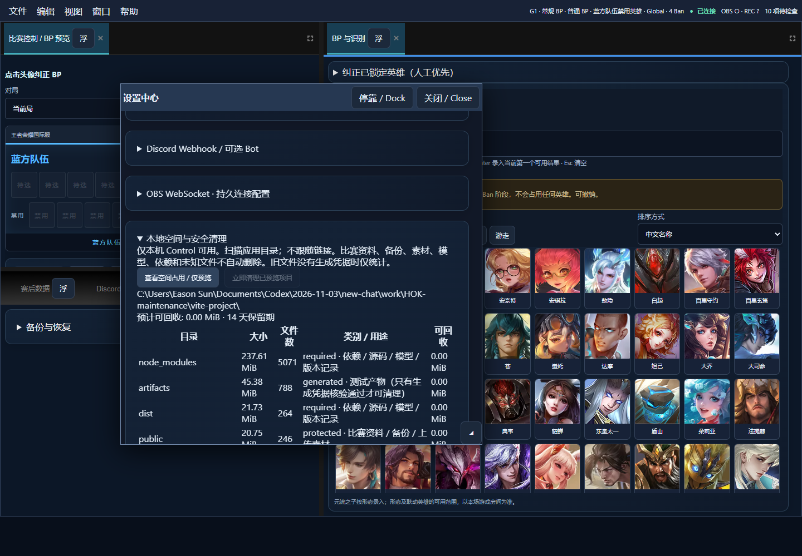

# 存储维护与 OCR 核验记录 — 2026-11-08

#115 已合入 main（`29d2212`）。该 PR 的 Broadcast system checks 与 Hero data sync 两项 GitHub Actions 最终均为 success。本页保留 11 月 8 日的本机测试与离线回放结果。[PR #115 检查](https://github.com/EaDen-Cen/Honor-of-Kings-International-Server-Tournament-Broadcasting-System/pull/115/checks) · [上传延迟验证](upload-latency.md)

基线：main `6b5abd9bb0f1d5a3fed9bc6646b26ac8c86f36a6`，包含 #112、#113。#114 已关闭未合并，本轮新建 `codex/storage-ocr-reliability`，独立实现与验证。没有重置比赛数据、修改生产凭证或合并/发布正式版本。

## 复现与修复

`node --import tsx --test server/hudOcrCache.test.ts` 在修改前失败：同一裁图第二次采样的 provider 调用数为 1，预期 2。空文本 / 低置信度结果确实占据 4 秒缓存。修复后上述回归通过，并覆盖格式不合法的高置信度文字。

缓存 ID 不变不能组成两次独立识别；相同解码像素不能伪装成新帧。新元数据使清晰字段独立更新，人工冻结、原字段范围和增速校验均保留。新增元数据曾使原完整候选对象相等测试失败；测试现在仍逐项断言全部原识别字段相等，同时断言同图像哈希一致、不同 OCR 调用证据 ID 不同，没有删除原语义检查。

Overlay 取消短期时钟推算，以免遮挡/暂停时继续显示未经核验的新秒数。新增浏览器测试验证等待后仍显示最后可信时间，之后接受新核验时间。

## 只读空间检查

已实际扫描本轮**新开发副本**的 `vite-project`，不是用户日常运行目录，也不是整块磁盘。扫描完整、未触发删除：依赖约 237.61 MiB（5,071 文件），public 素材约 20.75 MiB（246 文件），server 约 6.52 MiB。首次没有已过期且有生成凭据的产物，可回收为 0。

面板和 `npm run storage:inspect` 已交付；用户实际目录应以本机扫描为准。运行期未执行真实资料清理。删除测试只在自行创建的临时目录中运行，覆盖过期/未过期、写入后变化、报告引用、人工保留、重复运行、限额、恢复配置和 BO7 三局隔离。



Windows junction：预览后替换白名单子目录，清理拒绝，外部目标完整保留。硬链接保护通过。Windows 文件 symlink 创建返回权限不足，该子场景未实测；日志有明确诊断，不把 junction 测试等同文件 symlink 实测。

## 同批 OCR 回放

采集与回放分开：本轮没有运行中的雷电，不能补采同步三阶段或重连性能。使用已保存的 2026-11-05 真实模拟器顶栏 30 帧，按当时逐帧视觉核验记录标注；第 15 帧时间修正为 01:25、第 20–22 帧红经济为 4.1k。另用明确标为 synthetic 的 22 帧演示完成时钟遮挡/解除链路。

这里的“发布”指回放工具实际通过内存 Store 的权威动作提交，不是生产 OBS 已播出。下表“未提交”包括首帧、缓存重复、未通过一致性等；不等同 OCR 字符拒识。

### 已保存的真实模拟器画面：每字段 30 个标注

| 字段 | 改前正确数 | 改后正确数 | 改前/改后未提交数 | 改前/改后错误提交 |
|---|---:|---:|---:|---:|
| 蓝击杀 | 30 | 30 | 3 / 5 | 0 / 0 |
| 红击杀 | 30 | 30 | 4 / 3 | 0 / 0 |
| 蓝经济 | 30 | 30 | 7 / 11 | 0 / 0 |
| 红经济 | 27 | 27 | 7 / 6 | 0 / 0 |
| 蓝塔 | 30 | 30 | 3 / 19 | 0 / 0 |
| 红塔 | 30 | 30 | 3 / 4 | 0 / 0 |
| 时间 | 29 | 29 | 3 / 3 | 0 / 0 |

总计 206/210 正确（98.10%），改前改后一致；三个红经济误识别和一个时钟漏识别没有变成错误提交。新独立证据门槛会减少部分静态字段的重复提交，不能宣传为准确率提高。该组没有真实遮挡/解除阶段，恢复时间不适用，也不满足遮挡验收素材要求。

### 构造遮挡回放：每字段 22 个标注

| 字段 | 改前/改后正确数 | 改前/改后未提交数 | 遮挡阶段错误提交（前/后） | 改后解除后首次正确提交 |
|---|---:|---:|---:|---|
| 蓝击杀 | 22 / 22 | 9 / 18 | 0 / 0 | 第 3 帧，2 秒 |
| 红击杀 | 22 / 22 | 9 / 17 | 0 / 0 | 第 1 帧，0 秒 |
| 蓝经济 | 22 / 22 | 9 / 1 | 0 / 0 | 第 1 帧，0 秒 |
| 红经济 | 22 / 22 | 9 / 1 | 0 / 0 | 第 1 帧，0 秒 |
| 蓝塔 | 22 / 22 | 9 / 17 | 0 / 0 | 第 1 帧，0 秒 |
| 红塔 | 22 / 22 | 9 / 17 | 0 / 0 | 第 1 帧，0 秒 |
| 时间 | 15 / 15 | 9 / 9 | 0 / 0 | 第 2 帧，1 秒 |

构造的时钟遮挡持续 7 帧。改前时钟失效时所有字段停更；改后清晰经济继续提交，7 帧均无错误数字提交。时钟解除后由两个新有效观测恢复。**这不是无界趣连真实浮层的验收。**

离线 P95（文件读入→裁图→OCR→内存 Store）：最终模拟器组改前 174.27ms / 改后 153.99ms；构造组 143.85ms / 141.86ms。样本少且存在预热/调度差异，不据此宣称总体加速；不含真实截图、HTTP/WS ACK 或 OBS，真正端到端 P95 尚缺实测。

本地完整报告与逐帧记录：工作区 `outputs/storage-ocr-validation/` 下的 `emulator-report.json/html`、`synthetic-report.json/html`。新一轮真实素材按 [回放指南](../guides/hud-occlusion-replay.md) 建立标注即可复用同一工具。

可审查的机器可读汇总见 [A/B 结果 JSON](storage-ocr-replay-summary.json)，不包含私人原图或本地素材路径。构造组 `acceptance.passed=true`；模拟器组因缺少遮挡阶段为 `null`，没有用“零次错误”冒充完整验收。

## 自动与 Windows 检查

- Build：通过，保留已有大 chunk 提示。
- Format：核心文件检查通过。
- Lint：0 错误，原 AudienceVoteView 两条 Fast Refresh 警告。
- Unit/service：完整 415 项，413 通过、0 失败、2 项私人标注样本跳过；配置保存/调度等收尾后，12 项定向测试全通过。
- 最后追加凭据路径穿越防护后，存储 5 项复测通过；浮动设置面板 1 项复测通过。
- Playwright：前一轮 15 项相关流程全通过；完整 121 项中 120 通过、1 项原有 V2.2 panel 动画遮罩时序断言失败；原断言不变单独重复 3 次均通过，保留偶发失败记录。最终重新 build 后，空间面板、可信时钟与 GHUD 布局 5 项全部通过；完整套件未重跑，不能标记全绿。
- Windows：managed-process、tunnel-sync、launcher-session、launcher-smoke 四组通过；测试自己的进程和临时资料。
- BO7：正常 BP → 0 Ban、recordHeroes=false、contributeToFutureHistory=false 的盲选 → 正常 BP；盲选拒绝英雄写入，旧局 OCR context 拒绝，新局缓存重新识别，三局报告与引用证据保留。

复现命令：

```powershell
npm run build
npm run lint
npm run format:check
npm test
npm run test:e2e
node --import tsx --test server/storageMaintenance.test.ts server/maintenanceBo7.test.ts server/hudEvidence.test.ts server/hudOcrCache.test.ts
powershell -NoProfile -ExecutionPolicy Bypass -File scripts/managed-process.test.ps1
powershell -NoProfile -ExecutionPolicy Bypass -File scripts/tunnel-sync.test.ps1
powershell -NoProfile -ExecutionPolicy Bypass -File scripts/launcher-session.test.ps1
powershell -NoProfile -ExecutionPolicy Bypass -File scripts/launcher-smoke.test.ps1
```

## 未完成的实机验收

真实赛事素材计数 **0**；本轮无界趣连同步正常/遮挡/解除采集 **0**。缺少元流辅助真实误判裁图、真实中立资源图标与多分辨率资料，因此头像独立回归仍是合成图，资源类型仍需人工核对。没有安装或跑分 PaddleOCR，没有复制 BetterGI GPLv3 代码/权重，没有改变正常比赛的默认本地识别引擎。

长期 OBS 并发、真实 ADB 断线恢复、新版本实战采集速度、真实采样→ACK→Overlay P95 和 Windows 文件 symlink 场景仍待验收。已有约 0.63fps 的 ADB 数据属于前轮短时测量，不作为本轮实测或 1Hz 达标结论。
